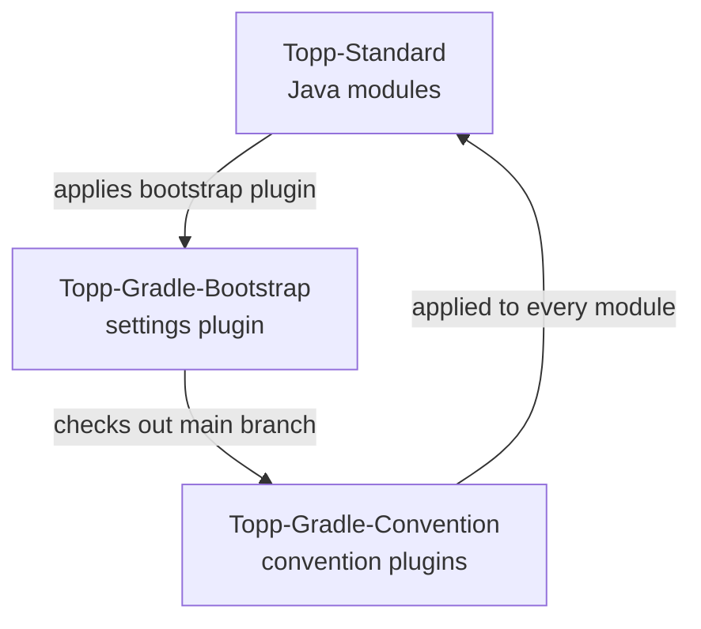

# Topp Standard @ Yelstream

[](https://central.sonatype.com/search?q=com.yelstream.topp.standard)
[](#technical-constraints)
[](#built-for-whats-next)
[](#built-for-whats-next)
[](LICENSE)
[](https://github.com/sabroe/Topp-Standard/commits/main)

Small, strict, composable Java libraries —
JPMS to the core, zero warnings, continuously on Maven Central.

Topp Standard is a collection of modular Java libraries developed in the open.
Each module evolves independently — from early experimentation to stable production use — while remaining usable and versioned at every meaningful stage.

Rather than forming a single framework, the project focuses on small, focused building blocks that can be combined and integrated across Java SE and Jakarta EE applications.



## Setup

The build spans three GitHub repositories:

1. [Topp-Gradle-Bootstrap](https://github.com/sabroe/Topp-Gradle-Bootstrap) — the `bootstrap` settings plugin; checks out and wires in the conventions.
2. [Topp-Gradle-Convention](https://github.com/sabroe/Topp-Gradle-Convention) — the shared Gradle convention plugins applied to every module.
3. [Topp-Standard](https://github.com/sabroe/Topp-Standard) — this repository; the Java modules themselves.



To use the same setup, clone Topp-Gradle-Bootstrap to `~/.topp/gradle/script/Topp-Gradle-Bootstrap` and add to `settings.gradle.kts`:

```kotlin
pluginManagement { includeBuild("${System.getProperty("user.home")}/.topp/gradle/script/Topp-Gradle-Bootstrap") }
plugins { id("bootstrap") }
```

Topp Standard *chooses* to use the bootstrap — nothing forces it. A local clone of Topp-Gradle-Convention,
included with `includeBuild(...)`, works just as well. The benefit: the conventions follow its `main` branch automatically.

## Built for what's next

- **Ready for Gradle 10** — tracks Gradle release candidates, runs with all deprecation warnings visible, and enables `NO_IMPLICIT_LOOKUP_IN_PARENT_PROJECTS` so Gradle 10 behavior applies already today.
- **Configuration Cache, always on** — Gradle's configuration cache (incubating since 6.6, stable since 8.1) is enabled in all three builds, and any cache problem fails the build.
- **On the road to Isolated Projects** — build logic avoids cross-project access, in preparation for Gradle's pre-alpha Isolated Projects feature.
- **Latest Java** — built on Java SE 27 via Gradle toolchains, strict JPMS modules, zero-warning compilation with `-Werror`.
- **Supply-chain aware** — every module ships a CycloneDX SBOM; dependencies are managed in a single version catalog.



## Small parts, big systems

Composable runtime systems build behavior from small, well-defined, replaceable parts — combined at the edges, not hardwired inside — that can be replaced or relocated without upfront coupling decisions.

This perspective unifies composition, correctness, evolution, and operability.

### Composition

Systems are dynamically assembled from independent components with explicit binding decisions made at the application level.

- Composition is defined at the application level, not embedded in frameworks  
- Protocol encoding is separate from transport  
- Components operate in-process or across processes  

### Structure

Systems are governed by static invariants that define correctness and coupling constraints.

- Contracts define structural boundaries between components  
- Dependencies are strictly directional and acyclic — cycles are design failures  
- State and behavior are localized to maintain high cohesion and avoid hidden coupling  
- Complexity is structured, not distributed — local scope remains simple, system behavior remains rich  

### Operation

Systems are designed for runtime observability and behavioral transparency.

- Behavior is exposed through stable interfaces — understandable without inspecting the implementation  
- Components are observable and testable in isolation  

### Evolution

Systems evolve continuously over time rather than remaining fixed artifacts.

- Code starts as exploration, then becomes structure  
- Components are named, shaped, and refined through use  
- Libraries may be split, merged, or re-scoped as understanding improves  
- Boundaries and responsibilities are not final at creation time  
- Concerns evolve along independent axes without forced synchronization  

Evolution is constrained by structural invariants and enabled by composability.

The system as a whole evolves continuously rather than through rewrites. 
Coherence emerges from this structured evolution, not from scale.

## Featured Modules

A selection of refined, production-ready modules. Each module is independently versioned and published.

| Artifact @ Maven Central                                                                                                                                         | JPMS Module @ JavaDoc                                                                                                                                            | Gradle Module @ GitHub                                                                                                                                                                               |
|------------------------------------------------------------------------------------------------------------------------------------------------------------------|------------------------------------------------------------------------------------------------------------------------------------------------------------------|------------------------------------------------------------------------------------------------------------------------------------------------------------------------------------------------------|
| [`topp-standard-operation-comparison`](https://central.sonatype.com/artifact/com.yelstream.topp.standard/topp-standard-operation-comparison)                     | [`com.yelstream.topp.standard.operation.comparison`](https://javadoc.io/doc/com.yelstream.topp.standard/topp-standard-operation-comparison)                      | [`:Core:Operation:Topp-Standard-Operation-Comparison-Library`](https://github.com/sabroe/Topp-Standard/tree/main/module/Core/Operation/Topp-Standard-Operation-Comparison-Library)                   |
| [`topp-standard-operation-reflection`](https://central.sonatype.com/artifact/com.yelstream.topp.standard/topp-standard-operation-reflection)                     | [`com.yelstream.topp.standard.operation.reflection`](https://javadoc.io/doc/com.yelstream.topp.standard/topp-standard-operation-reflection)                      | [`:Core:Operation:Topp-Standard-Operation-Reflection-Library`](https://github.com/sabroe/Topp-Standard/tree/main/module/Core/Operation/Topp-Standard-Operation-Reflection-Library)                   |
| [`topp-standard-operation-type`](https://central.sonatype.com/artifact/com.yelstream.topp.standard/topp-standard-operation-type)                                 | [`com.yelstream.topp.standard.operation.type`](https://javadoc.io/doc/com.yelstream.topp.standard/topp-standard-operation-type)                                  | [`:Core:Operation:Topp-Standard-Operation-Type-Library`](https://github.com/sabroe/Topp-Standard/tree/main/module/Core/Operation/Topp-Standard-Operation-Type-Library)                               |
| [`topp-standard-annotation-intention`](https://central.sonatype.com/artifact/com.yelstream.topp.standard/topp-standard-annotation-intention)                     | [`com.yelstream.topp.standard.annotation.intention`](https://javadoc.io/doc/com.yelstream.topp.standard/topp-standard-annotation-intention)                      | [`:Annotation:Topp-Standard-Annotation-Intention-Library`](https://github.com/sabroe/Topp-Standard/tree/main/module/Annotation/Topp-Standard-Annotation-Intention-Library)                           |
| [`topp-standard-stream-collection`](https://central.sonatype.com/artifact/com.yelstream.topp.standard/topp-standard-stream-collection)                           | [`com.yelstream.topp.standard.collection.stream`](https://javadoc.io/doc/com.yelstream.topp.standard/topp-standard-stream-collection)                            | [`:Core:Collection:Topp-Standard-Stream-Collection-Library`](https://github.com/sabroe/Topp-Standard/tree/main/module/Core/Collection/Topp-Standard-Stream-Collection-Library)                       |
| [`topp-standard-dual-access-io`](https://central.sonatype.com/artifact/com.yelstream.topp.standard/topp-standard-dual-access-io)                                 | [`com.yelstream.topp.standard.io.dual`](https://javadoc.io/doc/com.yelstream.topp.standard/topp-standard-dual-access-io)                                         | [`:Core:IO:Topp-Standard-Dual-Access-IO-Library`](https://github.com/sabroe/Topp-Standard/tree/main/module/Core/IO/Topp-Standard-Dual-Access-IO-Library)                                             |
| [`topp-standard-system-holder`](https://central.sonatype.com/artifact/com.yelstream.topp.standard/topp-standard-system-holder)                                   | [`com.yelstream.topp.standard.system.holder`](https://javadoc.io/doc/com.yelstream.topp.standard/topp-standard-system-holder)                                    | [`:Core:System:Topp-Standard-System-Holder-Library`](https://github.com/sabroe/Topp-Standard/tree/main/module/Core/System/Topp-Standard-System-Holder-Library)                                       |
| [`topp-standard-time`](https://central.sonatype.com/artifact/com.yelstream.topp.standard/topp-standard-time)                                                     | [`com.yelstream.topp.standard.time`](https://javadoc.io/doc/com.yelstream.topp.standard/topp-standard-time)                                                      | [`:Core:Time:Topp-Standard-Time-Library`](https://github.com/sabroe/Topp-Standard/tree/main/module/Core/Time/Topp-Standard-Time-Library)                                                             |
| [`topp-standard-time-legacy`](https://central.sonatype.com/artifact/com.yelstream.topp.standard/topp-standard-time-legacy)                                       | [`com.yelstream.topp.standard.time.legacy`](https://javadoc.io/doc/com.yelstream.topp.standard/topp-standard-time-legacy)                                        | [`:Core:Time:Topp-Standard-Time-Legacy-Library`](https://github.com/sabroe/Topp-Standard/tree/main/module/Core/Time/Topp-Standard-Time-Legacy-Library)                                               |

<!-- Hidden for now: work-in-progress modules. Remove this line and the closing marker to show them again.
A selection of work-in-progress, soon-to-be-production-ready modules. Each module is independently versioned and published.

| Artifact @ Maven Central                                                                                                                                         | JPMS Module @ JavaDoc                                                                                                                                            | Gradle Module @ GitHub                                                                                                                                                                               |
|------------------------------------------------------------------------------------------------------------------------------------------------------------------|------------------------------------------------------------------------------------------------------------------------------------------------------------------|------------------------------------------------------------------------------------------------------------------------------------------------------------------------------------------------------|
| [`topp-standard-xml-bind`](https://central.sonatype.com/artifact/com.yelstream.topp.standard/topp-standard-xml-bind)                                             | [`com.yelstream.topp.standard.xml.bind`](https://javadoc.io/doc/com.yelstream.topp.standard/topp-standard-xml-bind)                                              | [`:Data:XML:Topp-Standard-XML-Bind-Library`](https://github.com/sabroe/Topp-Standard/tree/main/module/Data/XML/Topp-Standard-XML-Bind-Library)                                                       |
| [`topp-standard-xml-process`](https://central.sonatype.com/artifact/com.yelstream.topp.standard/topp-standard-xml-process)                                       | [`com.yelstream.topp.standard.xml.process`](https://javadoc.io/doc/com.yelstream.topp.standard/topp-standard-xml-process)                                        | [`:Data:XML:Topp-Standard-XML-Process-Library`](https://github.com/sabroe/Topp-Standard/tree/main/module/Data/XML/Topp-Standard-XML-Process-Library)                                                 |
| [`topp-standard-xml-stream`](https://central.sonatype.com/artifact/com.yelstream.topp.standard/topp-standard-xml-stream)                                         | [`com.yelstream.topp.standard.xml.stream`](https://javadoc.io/doc/com.yelstream.topp.standard/topp-standard-xml-stream)                                          | [`:Data:XML:Topp-Standard-XML-Stream-Library`](https://github.com/sabroe/Topp-Standard/tree/main/module/Data/XML/Topp-Standard-XML-Stream-Library)                                                   |
| [`topp-standard-xml-time`](https://central.sonatype.com/artifact/com.yelstream.topp.standard/topp-standard-xml-time)                                             | [`com.yelstream.topp.standard.xml.datatype`](https://javadoc.io/doc/com.yelstream.topp.standard/topp-standard-xml-time)                                          | [`:Data:XML:Topp-Standard-XML-Time-Library`](https://github.com/sabroe/Topp-Standard/tree/main/module/Data/XML/Topp-Standard-XML-Time-Library)                                                       |
| [`topp-standard-core`](https://central.sonatype.com/artifact/com.yelstream.topp.standard/topp-standard-core)                                                     | [`com.yelstream.topp.standard.core`](https://javadoc.io/doc/com.yelstream.topp.standard/topp-standard-core)                                                      | [`:Topp-Standard-Core-Library`](https://github.com/sabroe/Topp-Standard/tree/main/module/Topp-Standard-Core-Library)                                                                                 |
| [`topp-standard-logging-slf4j-base`](https://central.sonatype.com/artifact/com.yelstream.topp.standard/topp-standard-logging-slf4j-base)                         | [`com.yelstream.topp.standard.logging.slf4j.base`](https://javadoc.io/doc/com.yelstream.topp.standard/topp-standard-logging-slf4j-base)                          | [`:Logging:SLF4J:Topp-Standard-Logging-SLF4J-Base-Library`](https://github.com/sabroe/Topp-Standard/tree/main/module/Logging/SLF4J/Topp-Standard-Logging-SLF4J-Base-Library)                         |
| [`topp-standard-logging-slf4j-proxy-logger`](https://central.sonatype.com/artifact/com.yelstream.topp.standard/topp-standard-logging-slf4j-proxy-logger)         | [`com.yelstream.topp.standard.logging.slf4j.spi.service.proxy`](https://javadoc.io/doc/com.yelstream.topp.standard/topp-standard-logging-slf4j-proxy-logger)     | [`:Logging:SLF4J:Topp-Standard-Logging-SLF4J-Proxy-Logger-Library`](https://github.com/sabroe/Topp-Standard/tree/main/module/Logging/SLF4J/Topp-Standard-Logging-SLF4J-Proxy-Logger-Library)         |
| [`topp-standard-logging-slf4j-console-logger`](https://central.sonatype.com/artifact/com.yelstream.topp.standard/topp-standard-logging-slf4j-console-logger)     | [`com.yelstream.topp.standard.logging.slf4j.spi.service.console`](https://javadoc.io/doc/com.yelstream.topp.standard/topp-standard-logging-slf4j-console-logger) | [`:Logging:SLF4J:Topp-Standard-Logging-SLF4J-Console-Logger-Library`](https://github.com/sabroe/Topp-Standard/tree/main/module/Logging/SLF4J/Topp-Standard-Logging-SLF4J-Console-Logger-Library)     |
| [`topp-standard-logging-slf4j-service-provider`](https://central.sonatype.com/artifact/com.yelstream.topp.standard/topp-standard-logging-slf4j-service-provider) | [`com.yelstream.topp.standard.logging.slf4j.provider`](https://javadoc.io/doc/com.yelstream.topp.standard/topp-standard-logging-slf4j-service-provider)          | [`:Logging:SLF4J:Topp-Standard-Logging-SLF4J-Service-Provider-Library`](https://github.com/sabroe/Topp-Standard/tree/main/module/Logging/SLF4J/Topp-Standard-Logging-SLF4J-Service-Provider-Library) |
-->

## Repository Overview

The featured modules represent only a small, curated subset of the project.
The repository currently contains ~55 modules across multiple stages of maturity, from experimental implementations to production-ready libraries.

Hence, the project serves three purposes:

- A continuously evolving collection of code, built over time through discovery, invention, and iterative refinement.
- A continuously published set of named artifacts for practical use via Maven Central.
- An exploration of an advanced Gradle multi-module architecture built on custom convention plugins and continuous module integration.

## Technical Constraints

- Internal dependencies are validated to be acyclic.
- Framework-agnostic by default, with selective integration for Spring Framework, Spring Boot, Quarkus, SmallRye, Eclipse MicroProfile, Jakarta EE (including CDI), SLF4J, and the MCP Java SDK.
- Zero warnings allowed: `-Xlint:rawtypes`, `-Xlint:unchecked`, `-Xlint:deprecation`, and `-Werror` on every module.
- Java SE 21 is the baseline for most modules; selected modules target up to Java SE 27.

## Published Artifacts

All artifacts, including those not featured above: https://central.sonatype.com/search?q=com.yelstream.topp.standard

This project reflects a systems design practice: small parts, hard boundaries, continuous evolution.

**-- Morten Sabroe Mortensen**
